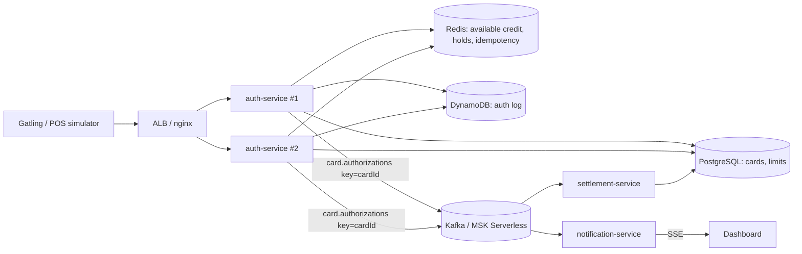

# Card Auth Engine

[](https://github.com/mini4141/card-auth-engine/actions/workflows/ci.yml)

Concurrency-safe credit-card **authorisation** microservices: thousands of purchases hit the same card at once and the credit limit must never be exceeded, even across multiple service instances.

The engine implements five interchangeable concurrency strategies (`naive`, `db-pessimistic`, `db-optimistic`, `redis-lock`, `redis-lua`), benchmarks them under load, runs 2 instances behind a load balancer, and streams approved authorisations through Kafka into a settlement service (PostgreSQL ledger) and a notification service (live dashboard over SSE). Every decision is audited in DynamoDB.

**Stack:** Java 21 (virtual threads) · Spring Boot 3.5 · PostgreSQL 17 + Flyway · Redis 7 (Lua, `SET NX`, Redisson) · Kafka / Amazon MSK Serverless · DynamoDB · Testcontainers · Gatling · Micrometer/Prometheus/Grafana/CloudWatch · Terraform · ECS Fargate · GitHub Actions.

- Proof (screenshots, logs, test reports): [proof/README.md](proof/README.md)
- Write-up: [docs/PORTFOLIO.md](docs/PORTFOLIO.md)
- Benchmarks: [docs/benchmarks.md](docs/benchmarks.md) · incident: [INC-001](docs/incidents/INC-001-overspend-naive.md) · design: [docs/system-design.md](docs/system-design.md)

## Architecture



## Quickstart (local)

Prerequisites: JDK 21, Docker Desktop, Node 20+ (proof screenshots only).

```bash
scripts/dev-up.sh            # builds jars, starts postgres/redis/kafka/dynamodb-local/prometheus/grafana, 2x auth-service behind nginx, seeds demo cards
open http://localhost:8080/dashboard/    # live dashboard   (grafana: :3000, prometheus: :9090)
scripts/bench-strategies.sh --vt-compare # benchmark all strategies -> docs/benchmarks.md
scripts/reconcile.sh                     # Redis vs Postgres vs ledger drift check
scripts/test-all.sh                      # unit + Testcontainers + 2-instance concurrency test + Gatling
scripts/capture-proof.sh phase1-local    # screenshots + logs into proof/
scripts/dev-down.sh
```

Try it by hand:

```bash
curl -s -X POST localhost:8080/cards -H 'Content-Type: application/json' -d '{"holder":"Alice","limit":100000}'
curl -s -X POST localhost:8080/authorizations -H 'Content-Type: application/json' \
  -H 'Idempotency-Key: demo-1' -H 'X-Strategy: redis-lua' \
  -d '{"cardId":"<id>","amount":1000,"merchant":"Cafe","mcc":"5814"}'
```

Endpoints: `POST /cards`, `GET /cards/{id}`, `PUT /cards/{id}/limit`, `POST /authorizations`, `POST /authorizations/{id}/reverse`, `GET /cards/{id}/authorizations` (DynamoDB audit), `POST /settlement/batches/run` (settlement-service :8081), `GET /admin/reconcile`, `GET /stream` (SSE), `/actuator/{health,prometheus}`, OpenAPI at `/swagger-ui.html`.

## Deploy to AWS / destroy

Everything runs from this PC, with the AWS profile `card-auth-engine-deployer` in `ap-southeast-2`. Infrastructure is Terraform in `infra/`; GitHub Actions never holds AWS credentials.

```bash
scripts/deploy.sh      # terraform apply, push images, wait healthy, seed, cloud benchmark, reconcile, capture proof/phase2-cloud
scripts/destroy.sh     # scale ECS to 0, empty ECR, terraform destroy, then verify-destroyed.sh
```

The stack is ephemeral (tagged `Ephemeral=true`) and costs roughly a dollar or two per hour while up; see the cost section of the write-up.

## Repository layout

```
services/auth-service/ settlement-service/ notification-service/
libs/domain/            shared event schema + Lua scripts
integration-tests/      Testcontainers: authorise -> Kafka -> ledger, 2-instance concurrency correctness
loadtest/gatling/       Gatling Java DSL simulation (burst + steady)
dashboard/              static dashboard served by notification-service
local/                  docker-compose, nginx, prometheus, grafana
infra/                  Terraform (VPC, ALB, ECS Fargate, RDS, ElastiCache, DynamoDB, MSK Serverless)
docs/ scripts/ proof/
```
