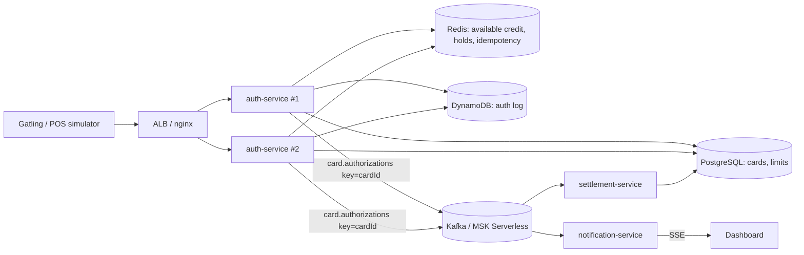

# SPECS.md: Card Auth Engine

## 1. Summary

The hot path of a credit-card issuer: **authorisation**. A purchase arrives, and the engine must decide in milliseconds whether the card has enough available credit. It must **never** let concurrent purchases overspend the limit, even with thousands of simultaneous requests across multiple service instances.

The engine implements four interchangeable concurrency strategies and benchmarks them:

| Strategy | Mechanism | Expected result |
|---|---|---|
| naive | read-then-write | Overspends |
| db-pessimistic | `SELECT … FOR UPDATE` | Safe |
| db-optimistic | version + retry | Safe |
| redis-lua | atomic hold | Safe, and the fastest |

Approvals stream through Kafka to a settlement service (PostgreSQL ledger + nightly batch) and a notification service (live dashboard). Every decision is logged to DynamoDB for audit and dispute lookup.

**Demo story:**
1. Fire 1,000 concurrent ¥1,000 authorisations at a card with a ¥100,000 limit.
2. `naive` approves 137 (overspend ¥37,000).
3. The three safe strategies approve exactly 100, and redis-lua does it at the lowest p99.
4. The dashboard streams the approvals live, settlement posts the ledger, and reconciliation finds zero drift.

## 2. Requirement coverage matrix

| Requirement | Covered by | Proof |
|---|---|---|
| Design, implement, deliver large-scale complex systems | 3 services + infra + benchmarks | Repo + proof |
| Leverage infrastructure for large-scale problems | Redis atomic holds, Kafka partitioning, DynamoDB log, ALB scale-out | Benchmarks |
| Triage, debug, root cause; support code in production | `docs/incidents/INC-001-overspend-naive.md` (root-causing the naive race with logs and metrics), reconciliation job | Doc + logs |
| Spring Boot professional use | All services | CI |
| RDBMS + NoSQL + distributed cache | PostgreSQL + DynamoDB + Redis | Logs |
| Data structures, algorithms, OOP fundamentals | Strategy pattern, token-bucket/limit maths, clean domain model | Code |
| In-depth concurrency + distributed computing | 4 strategies, the multi-instance correctness test, virtual threads, Redisson lock | Tests + benchmarks |
| RESTful APIs, Pub/Sub, DB clients (preferred) | REST, Kafka, JPA/DynamoDB/Redis clients | — |
| System design for high traffic (preferred) | `docs/system-design.md`: capacity estimate, hot-key handling, failure modes | Doc |
| Microservices + event-driven (preferred) | Kafka-driven settlement + notifications | Logs |

## 3. Architecture



## 4. Repository layout

```
services/auth-service/  services/settlement-service/  services/notification-service/
libs/domain/            shared domain model + event schema (Java records, JSON)
dashboard/              static assets served by notification-service
loadtest/gatling/       Java DSL simulations
local/                  docker-compose.yml (postgres, redis, kafka, dynamodb-local, prometheus, grafana, nginx), nginx.conf
infra/                  Terraform
docs/                   benchmarks.md, system-design.md, incidents/, adr/, PORTFOLIO.md
scripts/                bench-strategies.sh, reconcile.sh, ...
```

## 5. Features (end-to-end)

### F1: Card management (seed + API)
- `POST /cards {holder, limit}`, `GET /cards/{id}` (limit, available, holds) and `PUT /cards/{id}/limit`. Redis is primed from Postgres when a card is created or its limit changes.
- **Accept:** a seeded card has available = limit.

### F2: Authorisation API
- `POST /authorizations` (headers `Idempotency-Key`, `X-Strategy` (default from config)) with body `{cardId, amount, merchant, mcc}`. It returns `{authId, decision: APPROVED|DECLINED, reason, availableAfter}` with a p99 target < 50 ms locally (redis-lua).
- Each decision writes a DynamoDB log item and, if approved, a Kafka event.
- **Accept:** one approval and one decline (over the limit), each with a log item.

### F3: Concurrency strategies
- The `AuthorizationStrategy` interface has four implementations, selected per request (benchmark) or by config.
- **Accept:** the correctness test passes for the three safe strategies, and the naive strategy demonstrates overspend. That is an *expected* result asserted by the test: "naive overspends > 0".

### F4: Settlement
- It consumes approvals, writes ledger postings (`auth_id` UNIQUE) and captures the Redis hold through a Lua script. `POST /settlement/batches/run` (nightly cron in config; manual in the demo) aggregates per card per day.
- **Accept:** after a burst, sum(ledger) = limit − available for every card.

### F5: Notifications + live dashboard
- The notification service consumes approvals and declines and pushes them to `/stream` (SSE).
- The dashboard shows a live auth ticker, card gauges (available vs limit) and the latest benchmark table (read from `docs/benchmarks.json` or an API).
- **Accept:** during Gatling, the dashboard ticker moves and the gauges drop.

### F6: Benchmarks and incident write-up
- `bench-strategies.sh` runs a Gatling simulation per strategy, collects metrics from the API + Gatling, and writes `docs/benchmarks.md` + `benchmarks.json`.
- The incident doc root-causes the naive overspend: a lost-update race, shown with interleaved log lines from both instances.
- **Accept:** both docs exist with real numbers.

### F7: Reconciliation
- `scripts/reconcile.sh` (or `GET /admin/reconcile`) compares Redis available + holds with the Postgres limits and ledger for every card.
- **Accept:** zero drift after the demo burst (safe strategies only).

## 6. Data model

- **Postgres:**
  - `cards(id, holder, credit_limit, version)`
  - `ledger_postings(id, auth_id UNIQUE, card_id, amount, posted_at)`
  - `settlement_batches(id, card_id, day, total, created_at)`
  - `card_balances(card_id, available, version)` (used by the db-* strategies)
- **Redis:** `card:{id}:available` (int), `card:{id}:holds` (hash authId → amount), `idem:{key}` (decision JSON)
- **DynamoDB:** `auth_log(PK=CARD#id, SK=TS#iso#authId, decision, amount, merchant, strategy, latencyMs)`

## 7. Interfaces

- `/cards`
- `/authorizations`
- `/authorizations/{id}/reverse`
- `/settlement/batches/run`
- `/admin/reconcile`
- `/stream` (SSE)
- `/actuator/{health,prometheus}`
- OpenAPI via springdoc

## 8. Test plan

See CLAUDE.md §7. The correctness test spins up 2 auth-service instances with Testcontainers or compose and uses a `CountDownLatch` start gate with 1,000 virtual-thread clients.

## 9. Phase 1: Local

`docker compose up --scale auth-service=2` with nginx round-robin, Prometheus and Grafana.

- [ ] `tests/`: JUnit XML (unit + Testcontainers + correctness), Gatling HTML reports per strategy
- [ ] `docs/benchmarks.md` (numbers), `docs/incidents/INC-001-overspend-naive.md`
- [ ] `screenshots/01-dashboard-live.png`, `02-card-gauges.png`, `03-benchmark-table.png`, `04-grafana-latency-by-strategy.png`, `05-gatling-redis-lua.png`
- [ ] `logs/naive-race-interleaving.log`, `logs/reconcile.txt`, `logs/dynamodb-auth-log-query.json`, `logs/kafka-consume.txt`

## 10. Phase 2: AWS

| Local | AWS |
|---|---|
| compose auth ×2 + nginx | ECS Fargate auth-service ×2 behind an ALB |
| Postgres | RDS PostgreSQL |
| Redis | ElastiCache Redis OSS (`cache.t4g.micro`) |
| DynamoDB Local | DynamoDB on-demand |
| Kafka container | MSK Serverless (IAM SASL; topics created at start-up with AdminClient) |
| Prometheus/Grafana | CloudWatch metrics (Micrometer CloudWatch registry) + dashboard rendered through `get-metric-widget-image` |

`scripts/deploy.sh`:
1. `terraform apply`.
2. Push images.
3. Wait for healthy.
4. Seed the cards.
5. Run `bench-strategies.sh` against the ALB with lighter settings (for example 300 concurrent).
6. Run reconcile.

- [ ] `screenshots/01-cloud-dashboard-live.png`, `02-cloudwatch-latency.png`
- [ ] `tests/gatling-cloud/`, `logs/cloud-benchmarks.json`, `logs/cloud-reconcile.txt`, `logs/msk-describe.json`, `resources.txt`

## 11. Phase 3: Destroy

`terraform destroy` (MSK Serverless deletion can take several minutes, so wait).

`verify-destroyed.sh` checks for no ECS cluster, ALB, RDS instance, ElastiCache cluster, MSK cluster, DynamoDB tables or ECR repos.

## 12. Out of scope

Card network protocols (ISO 8583), 3-D Secure, fraud ML, statements and interest calculation.
