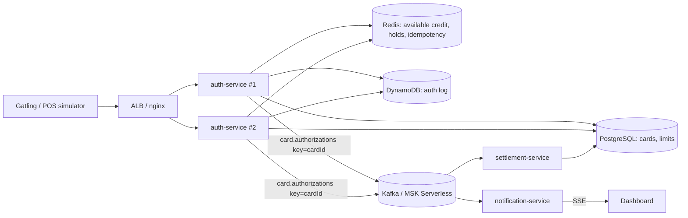
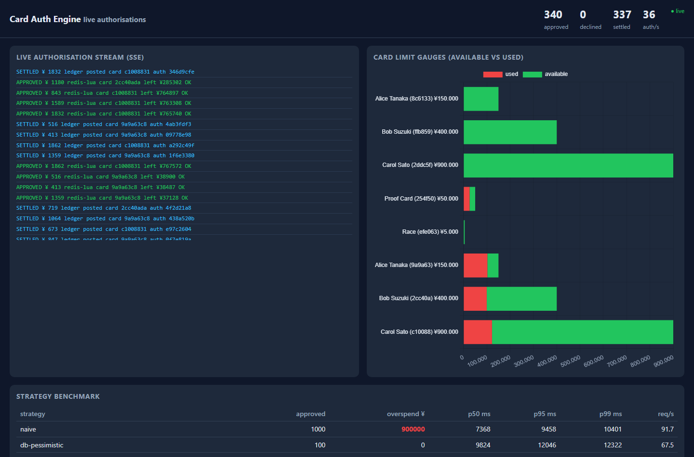
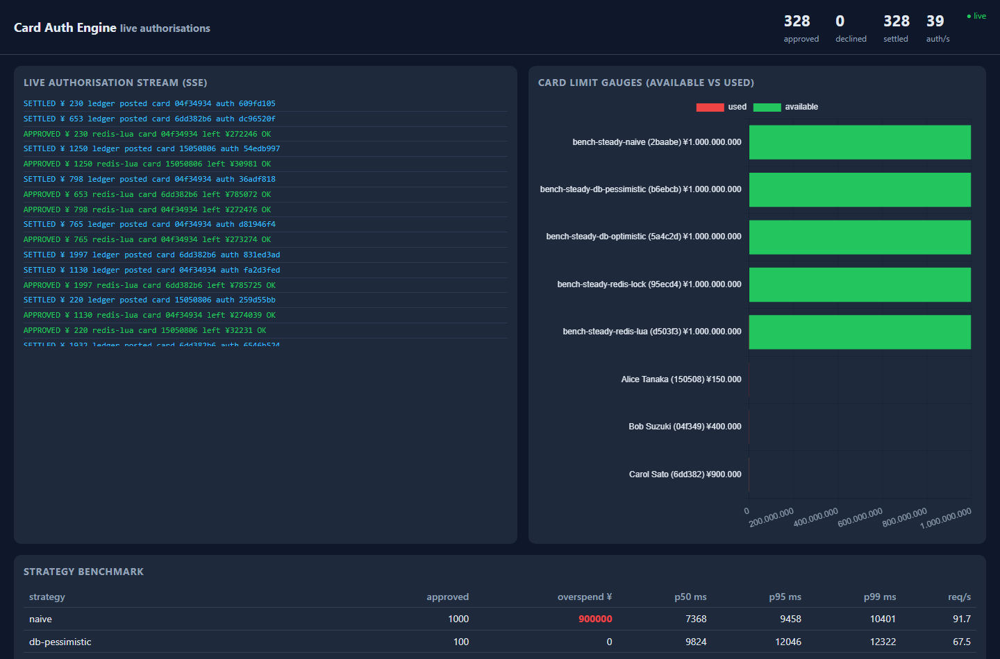
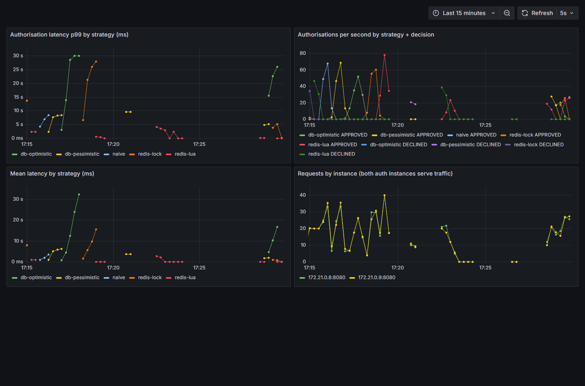
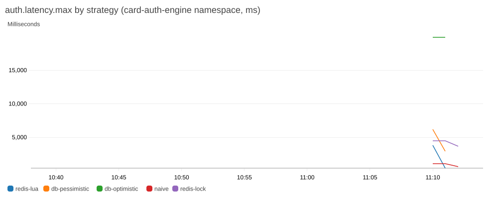

# Card Auth Engine: concurrency-safe credit-card authorisation

## The problem

A card issuer's hot path is **authorisation**: a purchase arrives and the system must decide in milliseconds whether the card has enough available credit. The hard part is not the decision, it is what happens when thousands of purchases hit the *same card* at once, across several service instances: the sum of approvals must never exceed the limit.

I built the engine to compare five concurrency strategies under load, run it as multiple instances behind a load balancer, stream approvals through Kafka into settlement and notification services, audit every decision in DynamoDB, and then deploy the whole thing to AWS with Terraform, prove it works, and tear it down.

**Result in one line:** 1,000 concurrent ¥1,000 authorisations against a ¥100,000 card: the naive implementation approved **all 1,000 (¥900,000 overspend)**; the four safe ones approved **exactly 100 (¥0 overspend)**, and the Redis Lua script was the fastest of them.

## Architecture



- **auth-service** (×2): `POST /authorizations` with an `Idempotency-Key`; strategy chosen per request (`X-Strategy`) or by config. Writes the decision to DynamoDB and publishes it to Kafka off the request path.
- **settlement-service**: consumes approvals, posts the ledger (`auth_id UNIQUE`, so redelivery is harmless), captures the Redis hold with a Lua script, runs the per-card/day batch. Poison messages go to a DLQ topic.
- **notification-service**: consumes decisions and settlements and pushes them to the dashboard over SSE.
- **Reconciliation** (`/admin/reconcile`, every minute): compares Redis available + holds, Postgres balances and the ledger per card; zero drift is the healthy state.

## Stack → requirement

| Requirement | Where it is in the code | Proof |
|---|---|---|
| Design/deliver large-scale systems, microservices + event-driven | 3 Spring Boot services, Kafka between them, Terraform for AWS | [proof/README.md](../proof/README.md), CI |
| Spring Boot (professional use) | Web, Validation, Actuator, Data JPA, Data Redis, Kafka, springdoc, structured JSON logs with trace IDs | CI badge in README |
| RDBMS + NoSQL + distributed cache | PostgreSQL 17 + Flyway (cards, balances, ledger, batches) · DynamoDB (audit log, Enhanced Client) · Redis 7 (holds, idempotency, card-profile cache) | [dynamodb log](../proof/phase1-local/logs/dynamodb-auth-log-query.json), [reconcile](../proof/phase1-local/logs/reconcile.txt) |
| Concurrency & distributed computing | Strategy pattern: `naive`, `db-pessimistic` (`FOR UPDATE`), `db-optimistic` (`@Version` + retry), `redis-lock` (Redisson), `redis-lua` (atomic hold); Java 21 virtual threads | [ConcurrencyCorrectnessIT](../integration-tests/src/test/java/com/cardauth/it/ConcurrencyCorrectnessIT.java), [benchmarks](benchmarks.md) |
| Redis features | Lua `hold`/`release`/`capture`, `SET NX` idempotency, Redisson distributed lock, cache-aside | [LuaHoldScriptTest](../services/auth-service/src/test/java/com/cardauth/auth/LuaHoldScriptTest.java) |
| Messaging | Kafka (KRaft locally, **MSK Serverless with IAM auth** in AWS); key = card ID for per-card ordering | [kafka-consume.txt](../proof/phase1-local/logs/kafka-consume.txt), [msk-describe.json](../proof/phase2-cloud/logs/msk-describe.json) |
| Triage, debug, root cause | [INC-001](incidents/INC-001-overspend-naive.md): the naive race root-caused from interleaved logs of both instances; reconciliation job | [race log](../proof/phase1-local/logs/naive-race-interleaving.log) |
| System design for high traffic | [system-design.md](system-design.md): capacity estimate, hot-key handling, failure modes | doc |
| Testing | JUnit 5, Testcontainers (Postgres, Redis, Kafka, DynamoDB Local), Awaitility, Gatling with assertions | [JUnit XML](../proof/phase1-local/tests/junit/), [Gatling](../proof/phase1-local/tests/gatling/) |
| Observability | Micrometer → Prometheus/Grafana locally, CloudWatch in AWS, JSON logs + trace IDs | screenshots below |
| AWS + IaC + CI | ECS Fargate ×4 tasks, ALB, RDS, ElastiCache, DynamoDB, MSK Serverless, ECR, CloudWatch via Terraform; GitHub Actions build + tests + Gatling | [infra/](../infra), [resources.txt](../proof/phase2-cloud/resources.txt) |

## Proof

**Live dashboard** (SSE stream of approvals and ledger postings, card gauges, benchmark table), local and on AWS:




**Latency per strategy** (Grafana locally; both auth instances take traffic) and **CloudWatch** in AWS:




**Benchmark** (1,000 concurrent ¥1,000 auths, ¥100,000 limit, 2 instances; full tables and the steady-load run in [benchmarks.md](benchmarks.md)):

| strategy | approved | overspend ¥ | p50 ms | p99 ms | req/s |
|---|---:|---:|---:|---:|---:|
| naive | 1000 | **900,000** | 7,368 | 10,401 | 91.7 |
| db-pessimistic | 100 | 0 | 9,824 | 12,322 | 67.5 |
| db-optimistic | 100 | 0 | 9,020 | 11,832 | 83.2 |
| redis-lock | 100 | 0 | 9,400 | 14,844 | 63.8 |
| **redis-lua** | 100 | 0 | **3,225** | **5,216** | **155.4** |

At a steady 100 auth/s on one card, `redis-lua` answers with p50 **22 ms** while the database and lock strategies queue for seconds (p50 5.8 s to 20 s). Those absolute numbers are bounded by running everything, including the load generator, in Docker Desktop on one laptop (about 300 req/s through its network even for a health check), so read the *ratios*, not the milliseconds. The p99 < 50 ms target was **not** met locally (steady-rate p99 was 687 ms).

The same suite ran on AWS (300 concurrent, 50 req/s steady, through the ALB from this PC; [cloud-benchmarks.md](../proof/phase2-cloud/logs/cloud-benchmarks.md)): naive approved 300 (¥200,000 overspend), the safe strategies exactly 100, and `redis-lua` was again the fastest safe strategy. Cloud reconciliation: zero drift on every safe-strategy card ([cloud-reconcile.txt](../proof/phase2-cloud/logs/cloud-reconcile.txt)).

## What was hard

- **Making the race real, then proving the fix.** The naive strategy had to overspend reliably, and the safe ones had to be tested *across instances*, not just threads. The correctness test starts two auth-service contexts against shared Testcontainers and fires 1,000 requests through a latch from virtual threads; for the safe strategies it asserts approved ≤ limit and ledger = holds, and for naive it asserts the overspend.
- **Blocking calls starve virtual threads.** Publishing to DynamoDB from virtual threads pinned the carrier threads and stalled request handling under burst. Moving the audit/Kafka publishing to a small platform-thread pool with bounded concurrency fixed it.
- **Benchmarking on Docker Desktop.** A 1,000-connection SYN burst is partly refused by Docker Desktop on Windows, so the first runs "failed" for the wrong reason. Injecting over 3 s and computing percentiles inside the simulation made the runs honest. Virtual threads helped `db-pessimistic` only modestly (p50 9.8 s vs 11.1 s) because the row lock and the 20-connection pool are the real limit, not the thread model.
- **Idempotency under retries across instances.** `SET NX` claims the key before any hold is placed and the decision replaces the placeholder; a retry on the other instance returns the stored decision.
- **Two services, one database.** Flyway had to baseline per service because both own tables in the same schema.
- **MSK Serverless + IAM.** Topics are created at start-up through the Kafka AdminClient with IAM auth; the task role is scoped to the cluster, topic and group ARNs.
- **Spring Boot 3 has no CloudWatch export.** The CloudWatch metrics never appeared on the first deploy; I wired `CloudWatchMeterRegistry` by hand (auth.* meters only) and redeployed.

## Approximate AWS cost

The stack was up for roughly an hour. Order-of-magnitude list prices in `ap-southeast-2`: MSK Serverless (cluster-hour plus partition-hours) about $0.8/h and dominates; Fargate 1.5 vCPU + 3 GB in total about $0.1/h; ALB, RDS `db.t4g.micro` and ElastiCache `cache.t4g.micro` about $0.03/h each; DynamoDB on-demand and CloudWatch cents. **Total ≈ US$1–2** for the whole showcase, with no NAT gateway. Everything is tagged `Project=card-auth-engine`, and [verify-destroyed.txt](../proof/phase3-destroy/verify-destroyed.txt) shows nothing billable left afterwards.

## How to reproduce

```bash
scripts/dev-up.sh && scripts/bench-strategies.sh --vt-compare   # local stack + benchmarks (docs/benchmarks.md)
scripts/test-all.sh                                              # unit + Testcontainers + 2-instance correctness + Gatling
scripts/capture-proof.sh phase1-local                            # screenshots + logs
scripts/deploy.sh                                                # AWS (profile card-auth-engine-deployer, ap-southeast-2)
scripts/destroy.sh                                               # destroy + verify nothing remains
```

Source: <https://github.com/mini4141/card-auth-engine>. Out of scope by design: card network protocols (ISO 8583), 3-D Secure, fraud ML, statements and interest.
